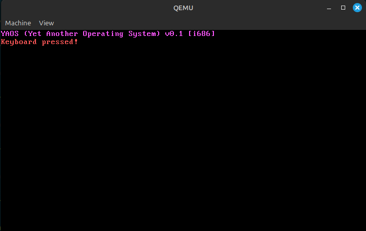

# YAOS (Yet Another Operating System)

YAOS is a 32-bit x86 operating system built from scratch using C and x86 Assembly. It focuses on bare-metal systems programming, hardware interaction, interrupt handling, and memory management.

## Features

Implemented an x86 bootloader that transitions the processor from 16-bit real mode to 32-bit protected mode using a Global Descriptor Table (GDT).

Implemented LBA-based disk I/O to load kernel sectors from disk into physical memory.

## Video Output

Implemented VGA text-mode output through direct memory-mapped access to video memory at 0xB8000.

## Interrupt Handling

Implemented and loaded a custom Interrupt Descriptor Table (IDT).

Configured and remapped the dual 8259 Programmable Interrupt Controllers (PIC) to handle hardware IRQs, enabling IBM Personal System/2 keyboard interrupt handling.

## Memory Management

Developed a kernel heap allocator (kzalloc) with block-based memory tracking and allocation/deallocation routines.

## Virtual Memory

Implemented 32-bit 2-level paging (1024 entries Page Directory and Page Tables) to map the 4 GB virtual address space with granular page permissions (Present, Writable, User), loading the directory base into CR3 and enabling hardware paging via bit 31 (PG) of CR0.

## Toolchain

C (GNU C99), x86 Assembly, i686-elf-gcc, NASM, GNU Make, QEMU.
